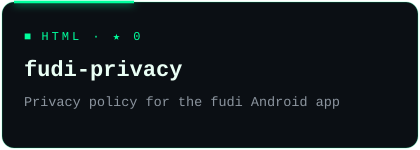
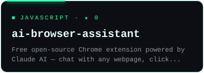
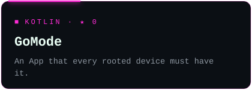
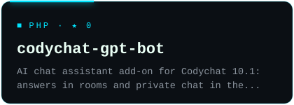
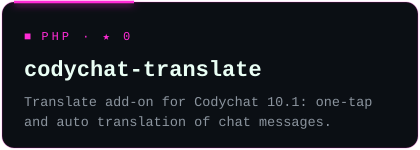
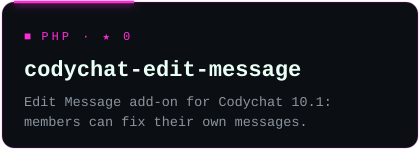

  

  

   
  type commands · crack the vault · find the easter eggs

  <b>AI-Powered Full-Stack Developer</b> · <b>Web Development</b> · <b>IT Solutions</b> 
  I plan, build and ship my projects with <b>AI as my co-pilot</b>, from idea to live product.

  
  
  
  
  
  
  
  
  
  

### `> ls ./projects`

<!-- PROJECTS:START -->

  
  
  
  
  
  

<!-- PROJECTS:END -->

  Latest public repos, refreshed daily

### `> cat stats.log`

  
  

  

### `> cat guestbook.log`

  

<!-- GUESTBOOK:START -->
| Visitor | Message | Date |
|:--|:--|:--|
|  [@cashifdev](https://github.com/cashifdev) | Welcome to my terminal, leave your mark 👾 | 2026-11-15 |
<!-- GUESTBOOK:END -->

### `> ./contact.sh`

  
  
  

⭐ If something here helps you, star it and follow for more.

